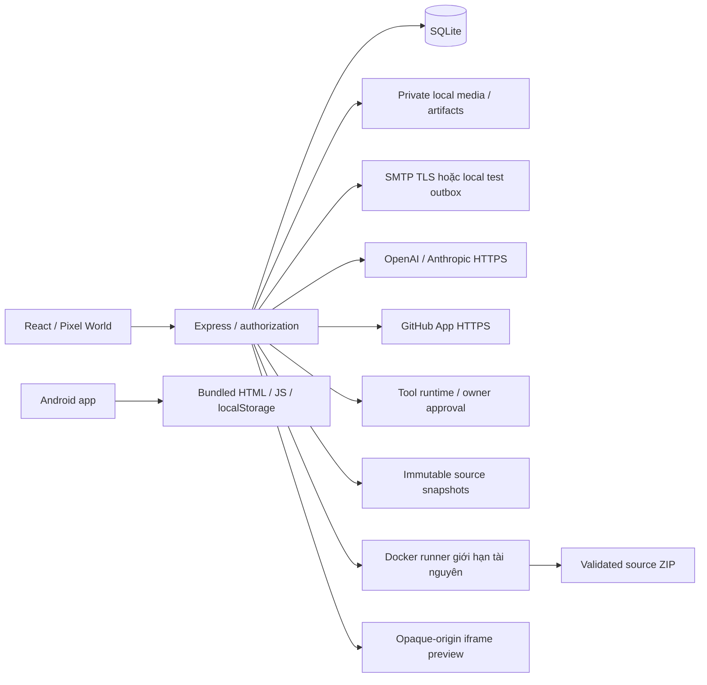

# Kiến trúc Pixel AI World

Website ở web/, chạy độc lập với Android Pixel AI Studio trong app/. Hai ứng dụng chưa đồng bộ dữ liệu. [Master prompt](MASTER_PROMPT.md) được giữ nguyên; [phase gates](PHASE_GATES.md) mô tả phạm vi đã kiểm chứng.

## Stack và ranh giới

React 19/TypeScript/Vite phục vụ SPA tiếng Việt, cùng-origin Express 4 trên Node.js 24. SQLite thực qua node:sqlite giữ tài khoản, nghiệp vụ, queue và ledger trên đĩa; WAL, foreign keys và transaction bảo vệ thao tác nhiều bảng. Đây là lựa chọn instance đơn, khác stack PostgreSQL/Prisma/Redis/BullMQ đề xuất; chưa hỗ trợ nhiều web/worker instance dùng chung dữ liệu.

Các mũi tên AI/GitHub/SMTP là đường implementation; kiểm chứng dịch vụ thật cần cấu hình và được ghi riêng. Không có lời gọi AI, commit, PR hoặc artifact giả khi chưa kết nối. Code người dùng chỉ chạy trong runner được bật rõ ràng, không chạy trực tiếp trên Node server quản trị.

## Module

| Đường dẫn trong web/ | Trách nhiệm |
|---|---|
| src/App.tsx, World.tsx | Layout, điều hướng, tài khoản/feed/project cơ bản và SVG làng gốc. |
| src/Identity.tsx, Community.tsx, ProjectPlanning.tsx | Tài khoản, media/kiểm duyệt và kế hoạch/cộng tác. |
| src/AIWorkspace.tsx và panel tích hợp | Queue/approval/budget, usage và GitHub/Build theo khả năng backend. |
| src/game-starter.ts | Bundle **Làng Đèn Nhỏ** tự chứa HTML/CSS/gameplay/test; cùng source đi qua runner rồi dùng làm artifact/preview. |
| server/app.ts, context.ts | App factory, auth/CSRF/rate limit, API cơ bản và context chung. |
| server/identity.ts, media.ts, community.ts | Token email, role/profile, upload và cộng đồng. |
| server/projects.ts | Capability, planning/lifecycle, review và SSE có kiểm tra lại quyền. |
| server/ai-providers.ts, ai.ts, ai-tools.ts | Adapter protocol/tool calls, tám role, queue, approval và budget ledger. |
| server/github.ts, integrations.ts, source-workspace.ts, build-runner.ts | GitHub App, snapshot xác định commit/blob, test-before-PR, approval bridge và Docker executor. |
| server/preview.ts | Lắp bundle đã build thành HTML độc lập, token preview gắn session và CSP sandbox. |
| server/db.ts, migrations/001–009 | Migration theo version trong transaction, bảo toàn database đã tồn tại. |
| server/index.ts | Listener/shutdown: dừng worker/stream, chờ HTTP hoàn tất rồi đóng DB. |
| tests/*.test.ts, e2e/ | HTTP/SQLite, protocol fixtures, Docker thực và browser workflows. |

Frontend dùng hash routing, gồm các trang chính và deep link cho hành động email/hồ sơ. Không tuyên bố đã cung cấp toàn bộ canonical routes của master prompt khi còn dùng modal/selection hoặc hash.

## Luồng liên kết

- User/session → post/comment/rating/media → follow/report/moderation → notification. Hidden content được kiểm tra cả ở route legacy.
- Email token chỉ lưu hash; xác minh yêu cầu đúng account. Reset dùng capability link và thu hồi tất cả session. Invitation production yêu cầu proof email.
- Studio questionnaire → private project + request task + owner/activity/notification trong một transaction. Chưa có provider thì intake không tự nhận đã phân tích.
- Project → milestone/task/dependency/checklist → revision/review → immutable version. SQL trigger chặn task còn phụ thuộc; update có version chống ghi đè.
- AI enqueue → atomic budget reservation → provider transport/tool calls bị giới hạn → usage settlement. Planner vẫn chờ duyệt trước khi tạo task/dependency. `read_project`/`read_tasks` chỉ đọc project hiện tại; đề xuất mã hoặc build được lưu bất biến và cần owner duyệt trước khi bridge thực thi. Không có quyền shell, push, merge hoặc deploy tùy ý.
- Owner liên kết repository qua App grant → snapshot text từ commit/tree/blob GitHub có checksum → ghép thay đổi → Docker kiểm thử → owner duyệt → kiểm tra lại base SHA → nhánh/PR. Local snapshot không tự cấp quyền tạo PR từ xa. Webhook xác minh raw-body HMAC và chống delivery trùng; hiện ghi event/activity, chưa phải đồng bộ source hoàn chỉnh.
- Build job → immutable text bundle → fixed checks/tests trong Docker → log/exit → source ZIP/hash/size → release có phê duyệt. Preview chỉ lấy bundle thành công, lắp script/CSS nội bộ và trả CSP `sandbox allow-scripts`; nội dung có opaque origin, không có quyền origin ứng dụng chính.
- Game starter → nút tạo bản chơi trong project → Docker chạy test gameplay thật → auto-open preview → di chuyển/va chạm/nhặt ba vật phẩm/giao nhiệm vụ/thắng/reset. Source không gọi AI hoặc lấy asset mạng. Project hash giữ context khi reload; game chưa lưu tiến độ.

SSE project/notification/job đọc lại quyền và phiên khi stream tồn tại. Queue/reservation/ledger bền vững trong SQLite; worker thuộc process đơn. Restart giữ evidence nhưng đánh dấu công việc có kết quả không chắc chắn để tránh tự gọi lại dịch vụ tốn phí.

## Phần chưa hoàn chỉnh

Có tám role và bốn tool bị giới hạn; việc có tên role không thay bằng chứng workflow agent chuyên môn đã gọi provider thật. Workspace là snapshot văn bản được cấp quyền, không phải Git checkout có shell hoặc dependency install. Runner/preview chỉ nhận web tĩnh; không hỗ trợ framework/Android/desktop target tùy ý. Preview hiện dùng CSP opaque-origin cùng route ứng dụng, không phải domain/host riêng. Chưa có PostgreSQL/Redis, object storage/S3, distributed workers, malware scanner hay backup scheduler. Đọc [SECURITY.md](SECURITY.md), [DATABASE.md](DATABASE.md), [DEPLOYMENT.md](DEPLOYMENT.md) trước khi mở rộng hoặc công khai.

Mở rộng 008/009/preview/game starter đã qua installer/full suite 174/174, năm browser gates 45/45 và browser tool workflow 5/5 ngày 2026-10-29. Provider/GitHub dùng transport fixture; Docker và Chromium chạy thật. UI source workspace/PR và dịch vụ ngoài chưa được suy ra là đạt từ các kết quả này. Đọc [PHASE_GATES.md](PHASE_GATES.md) cho phạm vi.
